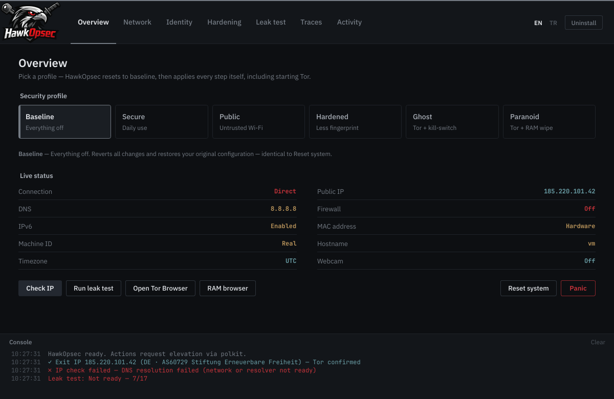
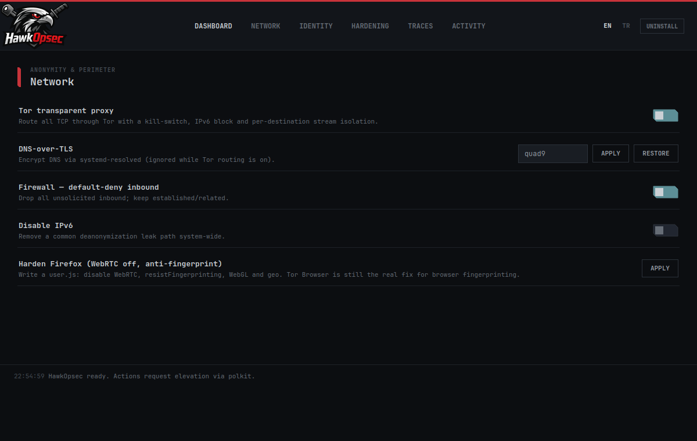
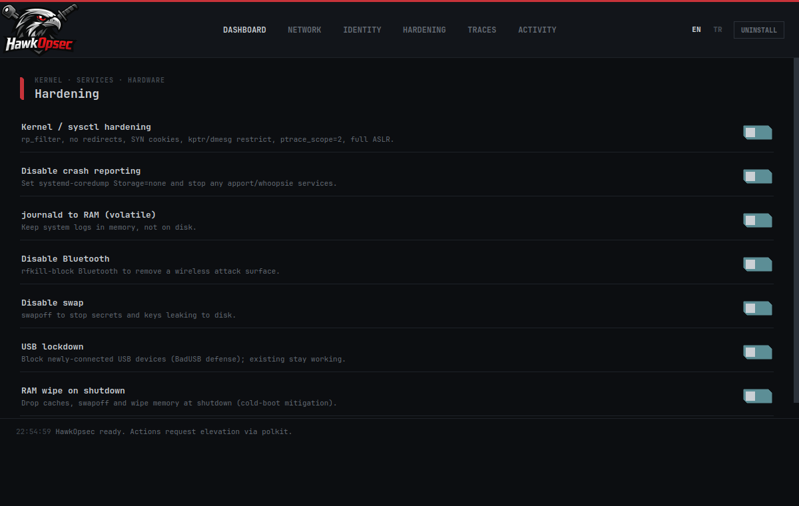
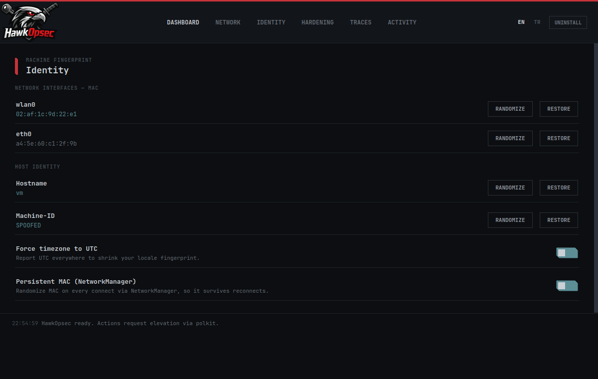
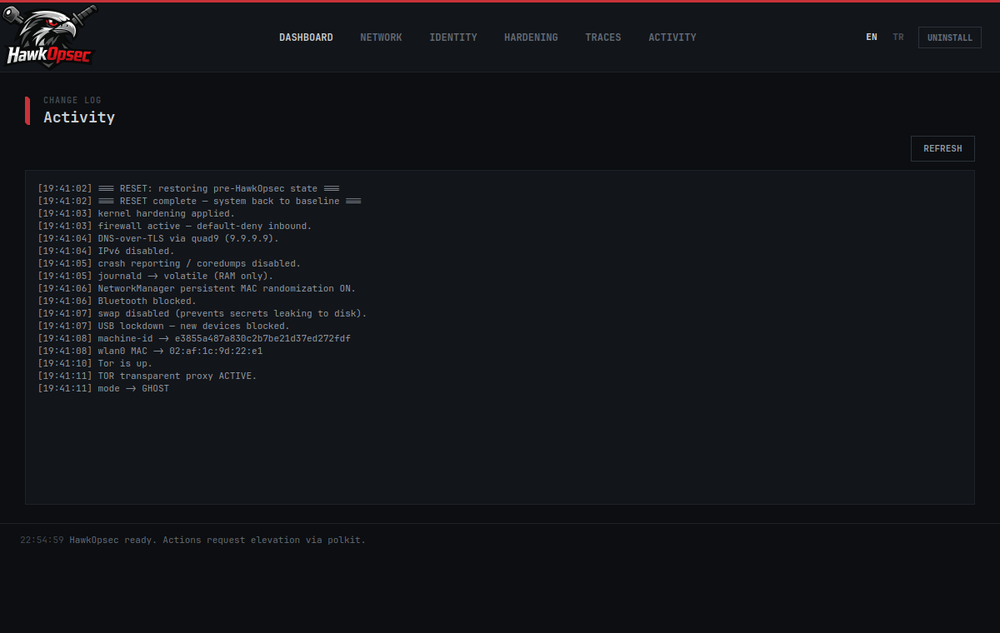

<p align="center">
  
</p>

<h1 align="center">HawkOpsec</h1>

<p align="center">
  <b>One-tap Linux OPSEC hardening & anonymity toolkit</b><br>
</p>

<p align="center">
  
  
  
</p>

---

HawkOpsec turns a pile of manual privacy commands into **security modes you apply with one tap**.
Pick a mode — the tool starts Tor, configures DNS, randomizes your identity and hardens the
kernel for you. Hit **RESET** and every change is rolled back from snapshots to your original state.

The GUI never runs as root; privileged actions go through a small helper via **polkit/pkexec**.
Every change is snapshotted before it is applied, so nothing is one-way.

<p align="center"></p>

## Security modes

Each mode resets to baseline first, then applies a full profile — switching is always clean.

| Mode | What it does |
|------|--------------|
| **BASELINE** | Everything off. Reverts all changes to the original state (same as RESET). |
| **SECURE** | Kernel hardening · default-deny firewall · DNS-over-TLS · IPv6 off · no crash reports · logs in RAM. No Tor — daily-driver safe. |
| **PUBLIC** | SECURE + MAC randomization (persistent via NetworkManager) + Bluetooth off. For untrusted / public wifi. |
| **HARDENED** | PUBLIC + random machine-id & hostname + swap off + USB lockdown. Strong anti-fingerprinting, no Tor. |
| **GHOST** | HARDENED + UTC timezone + **system-wide Tor routing** with a leak kill-switch. Full anonymity. |
| **PARANOID** | GHOST + RAM wipe on shutdown (cold-boot mitigation). Maximum protection. |

## Features

- **Network** — Tor transparent proxy (all TCP + DNS via Tor, kill-switch, IPv6 block, stream isolation), DNS-over-TLS (Quad9 / Cloudflare / Mullvad), default-deny firewall, IPv6 disable.
- **Identity** — per-interface MAC randomization, persistent MAC (NetworkManager), random hostname, machine-id spoofing, UTC timezone.
- **Hardening** — kernel/sysctl hardening, disable crash reporting/coredumps, journald to RAM, disable Bluetooth, disable swap, USB lockdown (BadUSB), RAM wipe on shutdown.
- **Traces** — clean shell history / recent files / thumbnails / trash, vacuum journald & coredumps, strip EXIF metadata (mat2/exiftool), secure-delete (shred).
- **Extras** — one-click anonymous browser (Tor Browser / Firejail), Firefox hardening (WebRTC off, resistFingerprinting), live exit-IP check, Activity log of every change, **RESET** and **PANIC**.
- **Bilingual UI** — switch English / Türkçe from the top-right; choice is remembered.

<p align="center">
  
  
</p>
<p align="center">
  
  
</p>

## Install

**Dependencies**

```bash
# Arch
sudo pacman -S --needed python-pyqt6 tor nftables polkit iproute2 rfkill systemd-resolvconf
# Debian / Ubuntu / Kali / Mint
sudo apt install -y python3-pyqt6 tor nftables policykit-1 iproute2 rfkill systemd-resolved
# optional extras: mat2 (or exiftool), secure-delete, firejail, torbrowser-launcher
```

**Run from source (quickest)**

```bash
python3 run.py                 # just run it
sudo ./packaging/install.sh    # or install: menu entry + launcher + polkit + helper
```

**Compile to a standalone binary (Nuitka)**

```bash
sudo apt install -y patchelf                 # or: sudo pacman -S patchelf
./packaging/build.sh                         # -> build/run.dist/hawkopsec
sudo ./packaging/install-compiled.sh
```

Then launch **HawkOpsec** from your application menu, or run `hawkopsec`.

## Uninstall

Click **UNINSTALL** in the app (or **HawkOpsec Uninstall** in the menu), or:

```bash
sudo ./packaging/uninstall.sh
```

It reverts every system change, removes all files and menu icons, and refreshes the desktop cache.

## Security note

HawkOpsec hardens the **network and system layers**. It does **not** make a normal browser
fingerprint-resistant — for real anonymous browsing use the built-in **Tor Browser** launcher,
avoid logging into personal accounts while anonymous, and remember that browser fingerprinting,
WebRTC and behavioural patterns are out of scope for a system tool. You are hardening *your own* machine.

## License

MIT — see [LICENSE](LICENSE).
